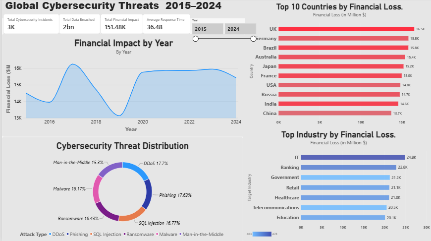

# CyberRisk Intelligence — Global Cybersecurity Threats (2015–2024)

[](https://powerbi.microsoft.com/)
[](https://www.kaggle.com/datasets/atharvasoundankar/global-cybersecurity-threats)
[](http://creativecommons.org/publicdomain/zero/1.0/)

An interactive business intelligence and cyber risk analytics dashboard developed in **Power BI Desktop**, analyzing a decade of global cybersecurity threat patterns, monetary impacts across key economic sectors, response times, and breach vectors.

---

## 📊 Dashboard Preview



---

## 🎯 Project Overview & Objectives

In modern corporate governance and enterprise risk management (ERM), cyber threats represent severe operational and financial solvency exposures. This project examines 3,000 global cybersecurity incidents recorded between 2015 and 2024 across 10 major economies and 7 industry verticals.

### Core Objectives:
- **Quantify Monetary Exposure:** Aggregate global financial losses and examine longitudinal trends over a 10-year period.
- **Identify Sectoral Risk:** Highlight high-exposure industries (such as IT and Banking) to support risk-based capital allocation and cyber insurance underwriting.
- **Evaluate Attack Vector Prevalence:** Assess the distribution of malicious techniques (DDoS, Phishing, Ransomware, SQL Injection, Malware, MitM).
- **Measure Operational Incident Response:** Track resolution agility across breach scenarios.

---

## 🛠️ Tools & Technologies

| Tool / Technology | Application |
| :--- | :--- |
| **Microsoft Power BI Desktop** | Data modeling, interactive visual development, UX layout, and dashboard design. |
| **Power Query (M)** | Data extraction, type validation, missing-value audits, and tabular shaping. |
| **DAX (Data Analysis Expressions)** | Calculated measures, aggregations (`SUM`, `AVERAGE`, `COUNTROWS`), and time-slicing logic. |
| **Python (Pandas, NumPy)** | Statistical verification, automated reconciliation, and exploratory data checks. |
| **Git & GitHub** | Source code management, semantic versioning, and project documentation. |

---

## 📈 Dashboard Features & KPI Architecture

The dashboard provides a single-pane executive risk overview structured around four high-level KPI cards and four detailed analytical visuals:

### 1. Executive KPI Cards
- **Total Cybersecurity Incidents (`3K`):** Total count of logged breach events across the 10-year horizon (3,000 incidents).
- **Total Data Breached / Disrupted Users (`2bn`):** Total volume of affected individuals / breach scale (1.51 billion records, rounded by default formatting).
- **Total Financial Impact (`151.48K` $M):** Cumulative monetary loss across all reported incidents ($151,478.91M, or **$151.48 Billion USD**).
- **Average Response Time (`36.48` Hours):** Mean technical resolution duration per security event.

### 2. Analytical Visualizations
- **Financial Impact by Year (Area / Line Chart):** Tracks cumulative monetary loss trends annually from 2015 through 2024, highlighting peaks in 2017 ($16.26B) and stabilization between 2020–2023 (~$15.8B–$15.9B).
- **Top 10 Countries by Financial Loss (Horizontal Bar Chart):** Compares total financial damages across the 10 sampled economies (led by the UK at $16.50B, Germany at $15.79B, and Brazil at $15.78B).
- **Top Industry by Financial Loss (Bar Chart):** Evaluates sector vulnerability across 7 industries, showing highest losses in Information Technology ($24.81B) and Banking ($22.77B).
- **Cybersecurity Threat Distribution (Donut Chart):** Visualizes the relative frequency of 6 primary attack types (DDoS 17.70%, Phishing 17.63%, SQL Injection 16.77%, Ransomware 16.43%, Malware 16.17%, Man-in-the-Middle 15.30%).
- **Interactive Year Range Slicer (2015–2024):** Dynamic slider allowing users to filter all visuals across custom date ranges.

---

## 📐 DAX Measures

The core analytical metrics are calculated using DAX expressions located in [`dax/measures.dax`](dax/measures.dax):

```dax
// Total cumulative financial impact across reported incidents ($M)
Total Financial Impact = 
SUM('Global_Cybersecurity_Threats_2015-2024'[Financial Loss (in Million $)])

// Total number of cybersecurity breach incidents
Total Cybersecurity Incidents = 
COUNTROWS('Global_Cybersecurity_Threats_2015-2024')

// Average incident resolution duration in hours
Average Response Time = 
AVERAGE('Global_Cybersecurity_Threats_2015-2024'[Incident Resolution Time (in Hours)])

// Scale of affected individuals / breach records
Total Data Breached = 
SUM('Global_Cybersecurity_Threats_2015-2024'[Data Breached (GB)])
// (Note: In the underlying dataset, this corresponds to [Number of Affected Users] = 1.51B)
```

---

## 🔍 Verified Analytical Findings

All analytical findings below are derived from data verification across the full 3,000 observations:

### 1. IT and Banking Bear ~31.4% of Global Financial Losses
- **Data Point:** IT incurred **$24,809.83M (16.38%)** and Banking sustained **$22,772.39M (15.03%)**, totaling **$47,582.22M** out of $151.48B global losses.
- **Pattern:** IT and Banking suffered 14.1% higher financial damage than the average across all seven industries ($21.64B).
- **Business Implication:** Organizations in high-capital, high-data-liquidity sectors face elevated loss severity per breach. Prioritizing zero-trust architecture, multi-factor authentication, and robust access controls in these sectors yields the highest risk-reduction dividend.
- **Caveat:** High compliance and mandatory disclosure laws in finance may lead to higher reporting fidelity relative to less regulated industries.

### 2. Broad Geographic Loss Distribution Across Major Economies
- **Data Point:** The United Kingdom sustained the highest total loss at **$16,502.99M** (321 incidents), closely followed by Germany (**$15,793.24M**) and Brazil (**$15,782.62M**).
- **Pattern:** Every country in the top 10 sustained between $13.7B and $16.5B, demonstrating that cyber threats represent a globally distributed systemic exposure rather than an isolated regional event.
- **Business Implication:** Multinational firms cannot focus risk mitigation on a single jurisdiction; cross-border data protection policies and localized incident containment plans are vital.
- **Caveat:** Incident frequency per country is relatively uniform in this dataset (~300 records each), reflecting curated sampling.

### 3. Balanced Attack Vector Dispersion
- **Data Point:** Distributed Denial of Service (DDoS) accounted for **17.70%** (531 events), Phishing accounted for **17.63%** (529 events), and Man-in-the-Middle represented **15.30%** (459 events).
- **Pattern:** The six threat types are evenly dispersed within a narrow 2.4 percentage-point band.
- **Business Implication:** Risk management frameworks must maintain defense-in-depth across multiple planes. Solely hardening network perimeter defenses or relying on user awareness training leaves significant attack surfaces exposed.
- **Caveat:** The balanced distribution indicates a synthetic or curated benchmark dataset.

---

## 🔬 Methodology & Limitations

1. **Unit Investigation:**
   - The dataset records financial losses in **Millions of US Dollars ($M)**. Total loss is `151,478.91` $M, which equates to **$151.48 Billion USD**. In Power BI, the automated display units render this as `151.48K` ($151.48K million).
   - The `Total Data Breached` card displays `2bn` due to Power BI rounding `1,514,052,409` affected users up to the nearest whole integer billion.
2. **Dataset Nature:** The dataset is a curated benchmark covering 3,000 balanced observations. While ideal for exploratory modeling and BI dashboard architecture, real-world breach telemetry exhibits greater clustering and long-tail outlier behavior.
3. **Data Model Inspection:** Power BI Desktop `.pbix` data models use internal VertiPaq XPress9 compression. Visual bindings, field mappings, and calculated metrics were independently verified using Python and report JSON definitions.

For in-depth analytical methodology, review [`docs/methodology-and-findings.md`](docs/methodology-and-findings.md).  
For the complete schema, consult [`docs/data-dictionary.md`](docs/data-dictionary.md).

---

## 📚 Dataset Source & Attribution

- **Dataset Title:** [Global Cybersecurity Threats (2015–2024)](https://www.kaggle.com/datasets/atharvasoundankar/global-cybersecurity-threats)
- **Author:** Atharva Soundankar
- **Platform:** Kaggle
- **Licence:** Creative Commons CC0: Public Domain (commercial and non-commercial redistribution permitted).
- **Redistribution:** The `.pbix` file is included in this repository. The original CSV can also be retrieved directly from Kaggle.

---

## 💡 What I Learned

- Designing executive-level BI dashboards adhering to clean visual hierarchy, coherent color harmony, and clutter-free KPI layouts.
- Structuring DAX measures and understanding display unit formatting nuances (e.g., millions vs. billions, card display units).
- Bridging financial principles (loss estimation, capital exposure, sector risk profiling) with cybersecurity telemetry.
- Managing data integrity and documenting ETL audit trails for professional repository presentation.

---

## 🚀 Future Improvements

- [ ] Create explicit DAX display measures that convert raw millions to formatted `$#,##0.00 "B"` for executive clarity.
- [ ] Add drill-through pages for granular deep-dives by specific country or target industry.
- [ ] Implement decomposition trees to visually trace root vulnerabilities (`Security Vulnerability Type`) to specific threat actors (`Attack Source`).
- [ ] Incorporate time-intelligence measures (YoY growth rate, rolling 3-year loss averages).

---

## 💻 How to View & Run the Project

### Option 1: View the Visuals
You can inspect the dashboard screenshot directly in [`dashboard/cyberrisk-dashboard.png`](dashboard/cyberrisk-dashboard.png) and read the analytical write-up in [`docs/methodology-and-findings.md`](docs/methodology-and-findings.md).

### Option 2: Open in Power BI Desktop
1. Ensure [Power BI Desktop](https://powerbi.microsoft.com/desktop/) is installed on your Windows machine.
2. Clone this repository:
   ```bash
   git clone https://github.com/alwin-meniens/Global-security-threats-Power-BI-dashboard.git
   cd Global-security-threats-Power-BI-dashboard
3. Open `cyberrisk-intelligence-dashboard.pbix` in Power BI Desktop to interact with the slicers and visuals.

---

## 👤 Author

**Alwin Meniens**  
